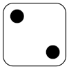
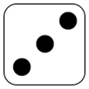
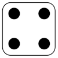
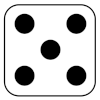
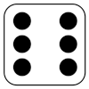

# Dice Roll Game

A dice game built in **C# with .NET MAUI**. Roll the dice and try to hit a winning total before you run out of attempts, or the computer wins.

  
  
  
  
  
  

## How to play

| Mode | Dice | You win on | Attempts |
|---|---|---|---|
| **Classic** | 2 | a total of **7** or **11** | 3 |
| **Three-Dice Mode** | 3 | a total of **11** or **18** | 3 |

- Press **Roll Dice**. The dice images update to show each roll, along with the total.
- Hit a winning total within 3 attempts and you win. If you don't, **the computer wins**.
- Flip the **Three-Dice Mode** switch to add a third die. Switching modes resets the board.
- Press **Reset** to start a new round.

## How it's built

- **`Game.cs`**: the game logic, kept separate from the UI. It rolls the dice with `Random`, stores each die in a private field exposed through a read-only property, counts attempts (max 3), checks the win rules for each mode, and resets the round.
- **`MainPage.xaml`**: the layout: three dice images (the third hidden until Three-Dice Mode is on), total and result labels, Roll / Reset buttons and the mode switch.
- **`MainPage.xaml.cs`**: event handlers that call `Game`, swap in the right dice image (`side_1.png` to `side_6.png`) and update the labels.

## Run it

This repo holds the app's source files (logic, UI and dice images). To run it, create a new **.NET MAUI App** in Visual Studio 2022, then copy in `Game.cs`, `MainPage.xaml`, `MainPage.xaml.cs` and put the `side_*.png` images in `Resources/Images`. Then press **F5**.

Targets .NET 8 (Windows, Android, iOS, Mac Catalyst).

## Tools

C# · .NET 8 · .NET MAUI · XAML · Visual Studio
